# Database schema

PostgreSQL schema (Supabase) for the course-management platform, defined in
[`supabase/migrations`](../centro-gg-frontend/supabase/migrations). 16 tables, 10 enum types,
indexes, `updated_at` triggers and Row Level Security on every table. Users live in Supabase's
`auth.users`; the application tables reference it.

## Entity-relationship diagram

Only primary keys, foreign keys and the main business columns are shown. Audit columns
(`created_at`, `updated_at`, `created_by`) are omitted for readability.

```mermaid
erDiagram
    AUTH_USERS ||--o| PROFILES : "has profile"
    AUTH_USERS ||--o{ USER_ROLES : "has roles"
    AUTH_USERS ||--o{ COURSE_TEACHERS : "teaches"
    AUTH_USERS ||--o{ ENROLLMENTS : "enrolls"
    AUTH_USERS ||--o{ ATTENDANCE : "attends"
    AUTH_USERS ||--o{ ASSIGNMENT_SUBMISSIONS : "submits"
    AUTH_USERS ||--o{ ASSIGNMENT_GRADES : "receives"
    AUTH_USERS ||--o{ PAYMENTS : "pays"
    AUTH_USERS ||--o{ CERTIFICATES : "earns"
    AUTH_USERS ||--o{ AUDIT_LOGS : "acts"
    COURSES ||--o{ COURSE_TEACHERS : "assigned to"
    COURSES ||--o{ ENROLLMENTS : "has"
    COURSES ||--o{ COURSE_SESSIONS : "has"
    COURSES ||--o{ MATERIALS : "has"
    COURSES ||--o{ ANNOUNCEMENTS : "has"
    COURSES ||--o{ ASSIGNMENTS : "has"
    COURSES ||--o{ CERTIFICATES : "issues"
    COURSES |o--o{ PAYMENT_ITEMS : "sold as"
    MATERIALS |o--o{ PAYMENT_ITEMS : "sold as"
    COURSE_SESSIONS ||--o{ ATTENDANCE : "records"
    ASSIGNMENTS ||--o{ ASSIGNMENT_SUBMISSIONS : "receives"
    ASSIGNMENTS ||--o{ ASSIGNMENT_GRADES : "graded in"
    ASSIGNMENT_SUBMISSIONS |o--o| ASSIGNMENT_GRADES : "evaluated by"
    PAYMENTS ||--o{ PAYMENT_ITEMS : "contains"

    AUTH_USERS {
        uuid id PK
    }
    PROFILES {
        uuid id PK, FK
        text email
        text full_name
        text cedula
        account_status status
    }
    USER_ROLES {
        uuid user_id PK, FK
        app_role role PK
    }
    COURSES {
        uuid id PK
        text slug UK
        text title
        numeric price
        smallint max_capacity
        course_status status
    }
    COURSE_TEACHERS {
        uuid course_id PK, FK
        uuid teacher_id PK, FK
    }
    ENROLLMENTS {
        uuid id PK
        uuid course_id FK
        uuid student_id FK
        enrollment_status status
    }
    COURSE_SESSIONS {
        uuid id PK
        uuid course_id FK
        text title
        timestamptz starts_at
        timestamptz ends_at
    }
    ATTENDANCE {
        uuid id PK
        uuid session_id FK
        uuid course_id FK
        uuid student_id FK
        attendance_status status
    }
    MATERIALS {
        uuid id PK
        uuid course_id FK
        material_kind kind
        boolean is_extra_purchase
        numeric price
    }
    ANNOUNCEMENTS {
        uuid id PK
        uuid course_id FK
        text title
    }
    ASSIGNMENTS {
        uuid id PK
        uuid course_id FK
        numeric max_score
        numeric weight
        timestamptz due_at
    }
    ASSIGNMENT_SUBMISSIONS {
        uuid id PK
        uuid assignment_id FK
        uuid student_id FK
        assignment_submission_status status
    }
    ASSIGNMENT_GRADES {
        uuid id PK
        uuid assignment_id FK
        uuid submission_id FK
        uuid student_id FK
        numeric score
    }
    PAYMENTS {
        uuid id PK
        uuid student_id FK
        payment_status status
        payment_method method
        numeric total
    }
    PAYMENT_ITEMS {
        uuid id PK
        uuid payment_id FK
        uuid course_id FK
        uuid material_id FK
        purchasable_item_type item_type
        numeric total
    }
    CERTIFICATES {
        uuid id PK
        uuid course_id FK
        uuid student_id FK
        text certificate_code UK
    }
    AUDIT_LOGS {
        uuid id PK
        uuid actor_id FK
        text action
        text table_name
        jsonb metadata
    }
```

## Design decisions

- **Roles as data, not columns.** `user_roles` has a composite key `(user_id, role)`, so a user can be
  student and teacher at once; the roles are `student`, `teacher` and `admin`.
- **Integrity in the database.** `CHECK` constraints enforce valid dates (`end_date >= start_date`),
  non-negative prices, `max_capacity` between 1 and 7, and score and weight ranges. `UNIQUE`
  constraints prevent duplicate enrollments, grades, submissions, attendance records and certificates.
- **Payments with line items.** `payment_items` can point to a course or a material, and a `CHECK`
  guarantees that the referenced target matches `item_type`.
- **Safe deletes.** Child rows use `ON DELETE CASCADE`; "who did it" columns use `ON DELETE SET NULL`
  so history survives when a user is removed.
- **Authorization in the database.** Row Level Security is enabled on all 16 tables, with role-based
  policies (59 in the initial migration), so access does not depend on hiding buttons in the UI.
- **Auditability.** `audit_logs` records the actor, action, table, record and a `jsonb` payload.
- **Storage.** Supabase Storage buckets hold course files, and a public `avatars` bucket holds profile
  pictures (second migration).

## Enum types

| Type | Values |
|---|---|
| `app_role` | student, teacher, admin |
| `account_status` | active, blocked |
| `course_status` | draft, published, open, in_progress, completed, cancelled, archived |
| `enrollment_status` | pending_payment, waitlisted, active, completed, cancelled, failed |
| `payment_status` | pending, paid, cancelled, refunded |
| `payment_method` | cash, bank_transfer, sinpe, card, other |
| `material_kind` | recipe, document, video, link, extra |
| `assignment_submission_status` | draft, submitted, late, graded |
| `attendance_status` | present, absent, late, excused |
| `purchasable_item_type` | course, material |
